# Wind Tunnel 

**Túnel de vento experimental instrumentado, com coleta de dados em tempo real, interface em Python e comparação aerodinâmica entre modelos em miniatura.**

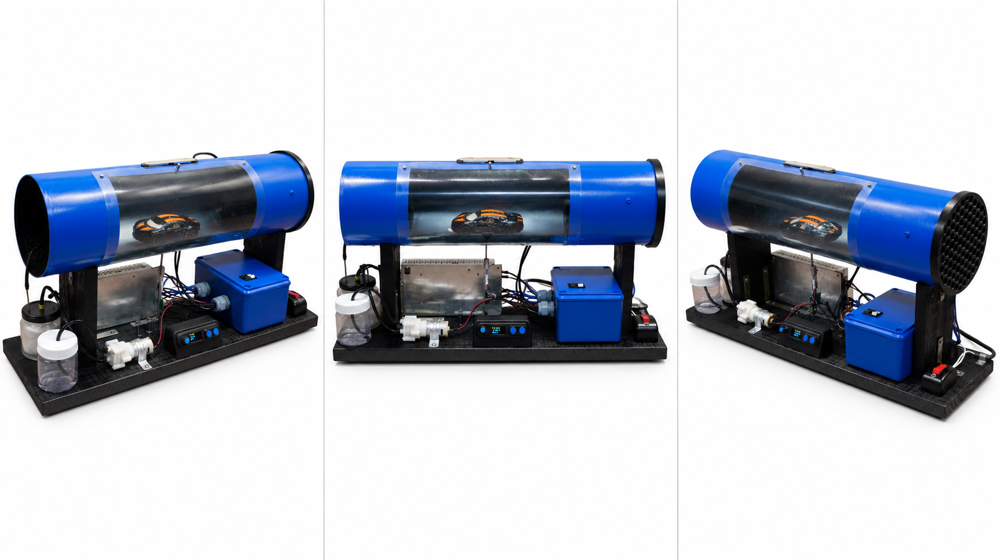

> Projeto autoral de engenharia experimental que integra mecânica, eletrônica, sensores, firmware (C++), software em Python e análise física dos resultados.

---

## Sumário

1. [O que é um túnel de vento](#1-o-que-é-um-túnel-de-vento)
2. [Finalidade do projeto](#2-finalidade-do-projeto)
3. [Aplicações na indústria e nas empresas](#3-aplicações-na-indústria-e-nas-empresas)
4. [Como o túnel foi construído](#4-como-o-túnel-foi-construído)
5. [Software de aquisição e análise (Python)](#5-software-de-aquisição-e-análise-python)
6. [Fundamentação física](#6-fundamentação-física)
7. [Metodologia dos ensaios](#7-metodologia-dos-ensaios)
8. [Resultados: Bugatti Chiron × Mercedes-Benz G500](#8-resultados-bugatti-chiron--mercedes-benz-g500)
9. [Discussão e análise crítica dos dados](#9-discussão-e-análise-crítica-dos-dados)
10. [Conclusões](#10-conclusões)
11. [Limitações e trabalhos futuros](#11-limitações-e-trabalhos-futuros)
12. [Segurança](#12-segurança)
13. [Autoria e licença](#13-autoria-e-licença)

---

## 1. O que é um túnel de vento

Um túnel de vento é um equipamento que produz um escoamento de ar controlado sobre um objeto fixo. Em vez de mover o carro pelo ar, mantém-se o carro parado e move-se o ar: as forças aerodinâmicas são as mesmas, mas passam a ser **medidas com instrumentos**, em ambiente repetível.

O Wind Tunnel 2.0 é um túnel de **circuito aberto, em escala reduzida**: um ventilador (motor DC com hélice) puxa/empurra o ar por um tubo, o ar atravessa um retificador de fluxo, passa pela seção de testes — onde o modelo está preso a uma célula de carga — e sai para o ambiente.

## 2. Finalidade do projeto

Transformar a pergunta *"este formato oferece mais ou menos resistência ao ar?"* em um **ensaio mensurável**. O equipamento mede:

| Grandeza | Sensor / método | Para que serve |
|---|---|---|
| Velocidade do ar | Anemômetro de hélice (Hall/pulsos) | Define a condição do escoamento |
| Força de arrasto | Célula de carga + HX711 | Resistência exercida sobre o modelo |
| Temperatura | Termistor NTC | Monitoramento do ambiente e do sistema de fumaça |
| Comando do ventilador | PWM (0–255) | Controle da vazão de ar |

Com velocidade e força, o software constrói a curva **Força × Velocidade** e estima o **coeficiente de arrasto (Cd)** de cada objeto, permitindo comparar formatos diferentes no mesmo gráfico.

## 3. Aplicações na indústria e nas empresas

O princípio do projeto é o mesmo usado em ensaios profissionais, em escalas e níveis de precisão muito maiores:

- **Indústria automotiva:** redução de arrasto para diminuir consumo de combustível e aumentar autonomia de veículos elétricos; estudo de sustentação, refrigeração e ruído.
- **Aeronáutica e drones:** ensaio de perfis de asa, fuselagens e hélices.
- **Motorsport e ciclismo:** ganhos de desempenho por ajuste de carenagem, posição do piloto e acessórios.
- **Construção civil e arquitetura:** efeito do vento em edifícios, pontes e coberturas.
- **Energia eólica:** teste de pás e protótipos de turbinas.
- **Embalagens, esportes e design de produto:** estudo de formas e estabilidade sob escoamento.
- **Educação e P&D:** bancada didática de instrumentação, aquisição de dados e método científico.

> O Wind Tunnel 2.0 é um instrumento **educacional e de prototipagem** — adequado para comparar formatos entre si e ensinar o método experimental, não para certificar valores absolutos de Cd.

## 4. Como o túnel foi construído

### 4.1 Visão geral

O conjunto é montado sobre uma base de madeira pintada de preto, com dois apoios que sustentam o tubo azul. Na lateral do tubo há uma **janela transparente** para observação, iluminada internamente por fita de LED. Ao lado ficam a fonte, a caixa eletrônica, o painel de controle e o sistema de fumaça.


### 4.2 Subsistemas

#### Ventilador (motor e hélice)
Motor DC fixado por um suporte impresso em 3D de três braços, no eixo do tubo, com hélice metálica. A velocidade é controlada por PWM.

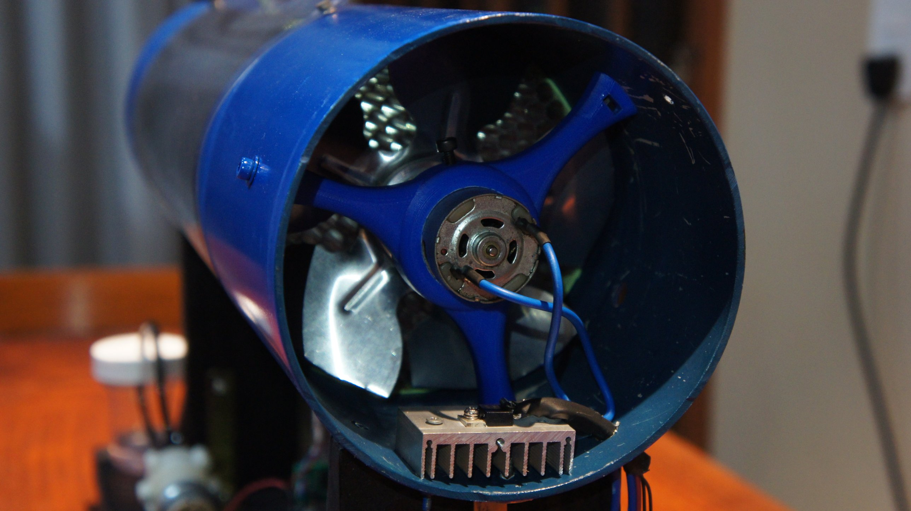

#### Acionamento (MOSFET e dissipador)
O estágio de potência que alimenta o motor usa um MOSFET montado em dissipador de alumínio, posicionado **dentro do tubo**, de modo que o próprio escoamento ajude no resfriamento.

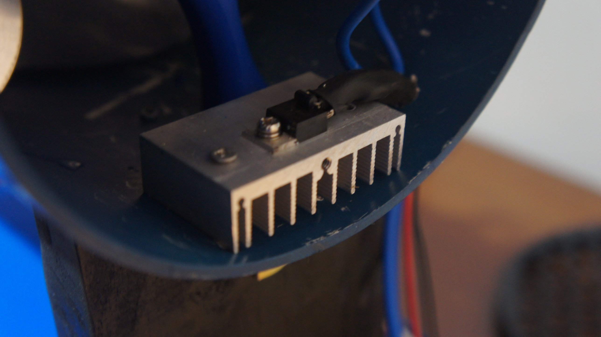

#### Retificador de fluxo (grade hexagonal)
Grade em favo de mel **impressa em 3D** na saída do tubo, que protege o ventilador e ajuda a organizar o escoamento. Veja a peça avulsa e já montada:

| Peça impressa | Montada no túnel |
|---|---|
| 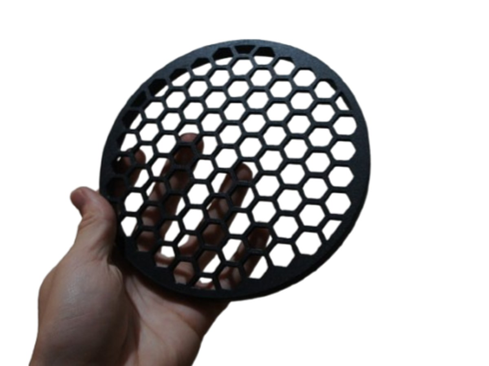 | 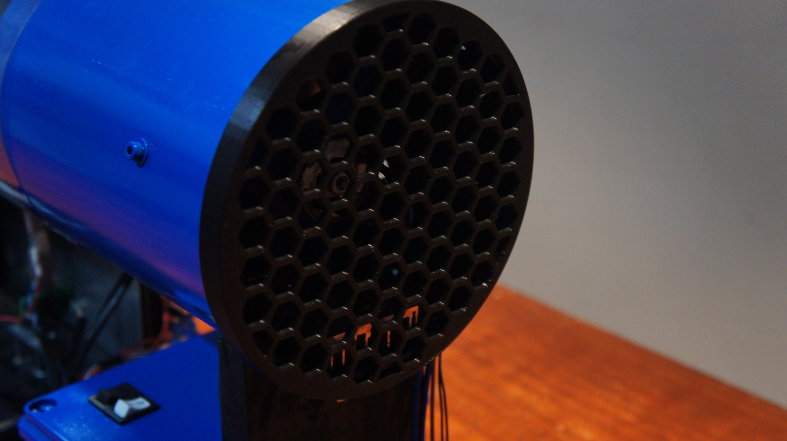 |

#### Anemômetro
Pequena ventoinha montada sobre uma colmeia de canudos, que transforma a rotação em pulsos para estimar a velocidade do ar.

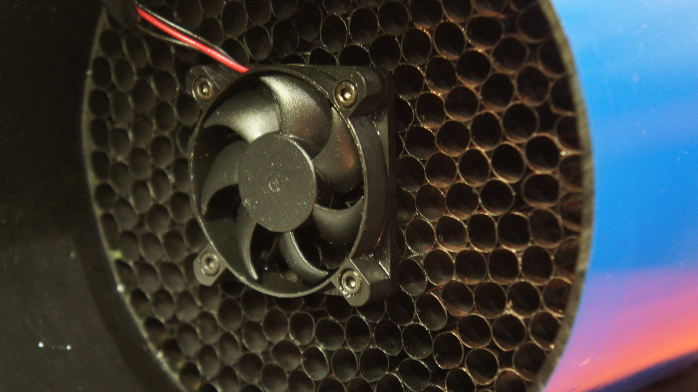

#### Medição de força (célula de carga)
Célula de carga do tipo barra, com módulo HX711 (placa verde). Uma haste vertical, que atravessa uma fenda na parte inferior do tubo, liga o modelo à célula — o suporte está fixado ao centro de massa do carrinho, medindo a força horizontal transmitida.

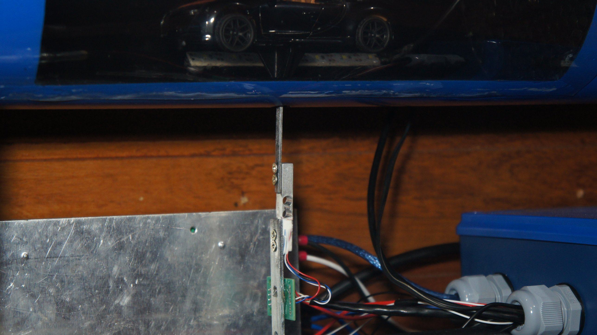

#### Painel de controle e display
Gabinete impresso em 3D com display OLED (velocidade em km/h, força em N e temperatura em °C), potenciômetro rotativo para controle manual de PWM e dois botões.

| Painel frontal | Ajuste manual de PWM |
|---|---|
| 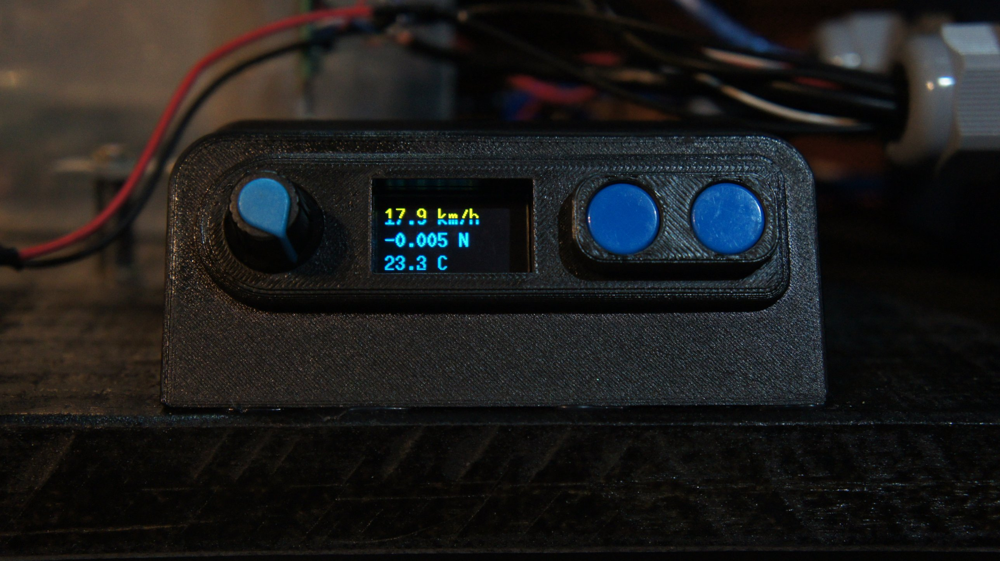 | 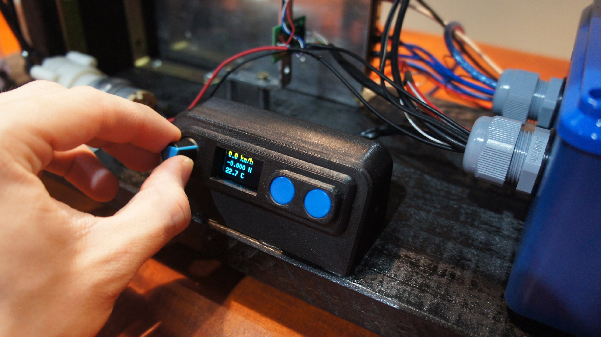 |

#### Botão de emergência e chave geral
Interruptor vermelho de emergência junto à base e chave geral na caixa eletrônica azul (com prensa-cabos para a passagem dos fios).

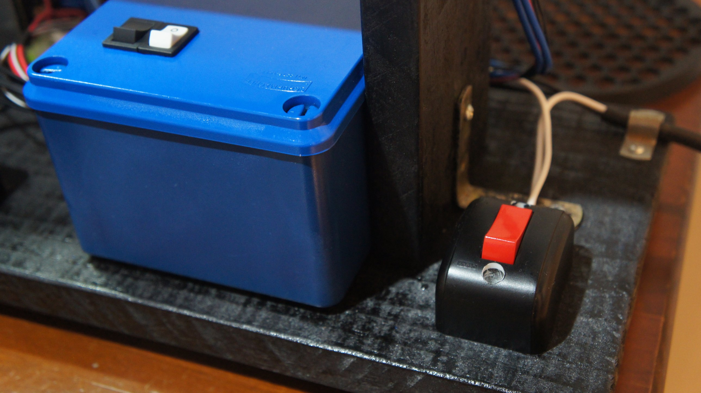

#### Sistema de fumaça (visualização do escoamento)
Reservatórios, bomba e elemento de aquecimento geram fumaça que é injetada no túnel, tornando as linhas de corrente visíveis ao redor do modelo.

| Sistema de aquecimento e bombeamento | Fluxo visível |
|---|---|
| 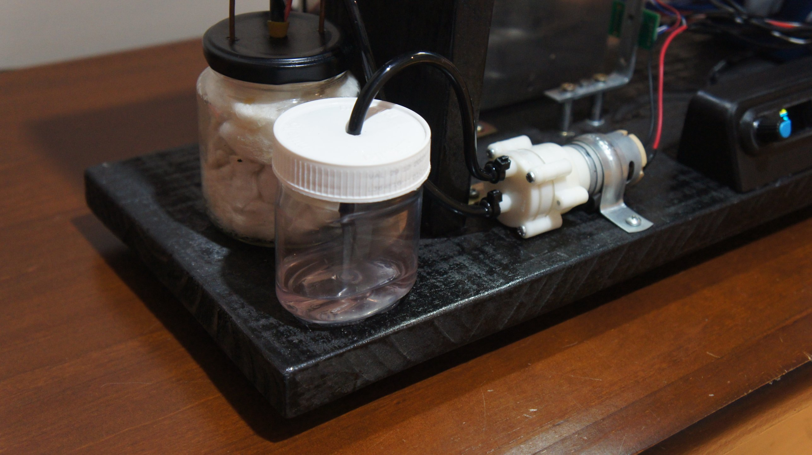 | 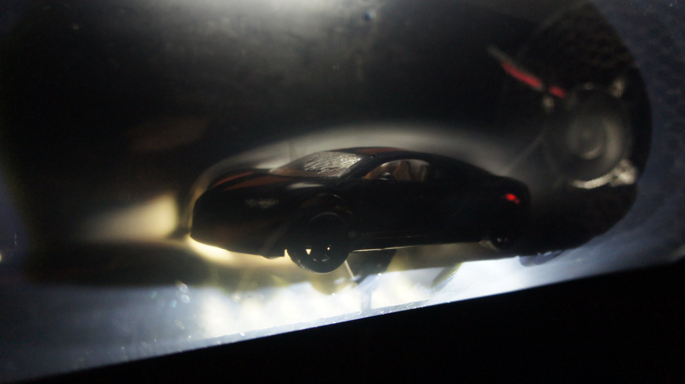 |

### 4.3 Eletrônica e firmware

Um microcontrolador lê os sensores (HX711, anemômetro, NTC), controla o PWM do ventilador, o relé/aquecimento da fumaça e o display OLED, e transmite os dados ao computador por **comunicação serial a 115200 baud**.

O código C++ está na pasta [`firmware/`](firmware/).

## 5. Software de aquisição e análise (Python)

O aplicativo **Wind Tunnel 2.0** (Tkinter + pyserial + matplotlib) funciona como estação de ensaio no computador.

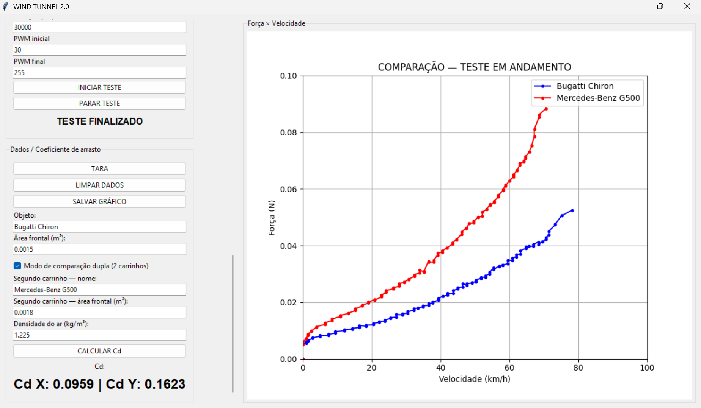

### Funcionalidades

- **Leitura serial em tempo real** de velocidade, força, temperatura e RPM.
- **Teste automático** com rampa de PWM (PWM inicial → PWM final) e tempo configurável.
- **Tara** da célula de carga e **limpeza** de dados.
- **Gráfico Força × Velocidade** com eixos fixos (0–100 km/h e 0–0,1 N) para comparar ensaios na mesma escala.
- **Modo de comparação dupla** (Carrinho X × Carrinho Y): o segundo teste não apaga o primeiro; curvas em azul e vermelho.
- **Cálculo do Cd** de cada objeto, usando a área frontal e a densidade do ar informadas.
- **Exportação** do gráfico em imagem, com nome do objeto, área, pico de força e Cd médio na legenda.

### Fluxo de uma comparação

1. Informar nome e área frontal do primeiro carrinho e executar o teste.
2. Trocar o modelo na seção de testes.
3. Informar nome e área frontal do segundo carrinho e executar o segundo teste.
4. O programa sobrepõe as curvas, calcula o Cd de cada um e salva o gráfico.

O código está na pasta [`software/`](software/).

## 6. Fundamentação física

A força de arrasto sobre um corpo em um escoamento é:

```
F_d = ½ · ρ · v² · C_d · A
```

Isolando o coeficiente de arrasto:

```
C_d = 2 · F_d / (ρ · v² · A)
```

| Símbolo | Significado | Unidade |
|---|---|---|
| F_d | Força de arrasto medida | N |
| ρ | Densidade do ar (padrão: 1,225) | kg/m³ |
| v | Velocidade do ar (km/h ÷ 3,6) | m/s |
| A | Área frontal de referência | m² |
| C_d | Coeficiente de arrasto | adimensional |

Dois pontos fundamentais:

- A força cresce, em primeira aproximação, com o **quadrado da velocidade**.
- O Cd **normaliza** a força pela pressão dinâmica e pela área, permitindo comparar objetos de tamanhos diferentes.

## 7. Metodologia dos ensaios

| Item | Configuração |
|---|---|
| Objetos | Bugatti Chiron (miniatura) e Mercedes-Benz G500 (miniatura) |
| Área frontal | Chiron: 0,0015 m² · G500: 0,0018 m² |
| Densidade do ar | 1,225 kg/m³ |
| Rampa de PWM | 30 → 255 |
| Repetições | 3 ensaios (Teste 3, Teste 4, Teste 5) |
| Saída | Curva Força × Velocidade, pico de força e Cd médio |

### Os modelos testados

| Bugatti Chiron | Mercedes-Benz G500 |
|---|---|
| 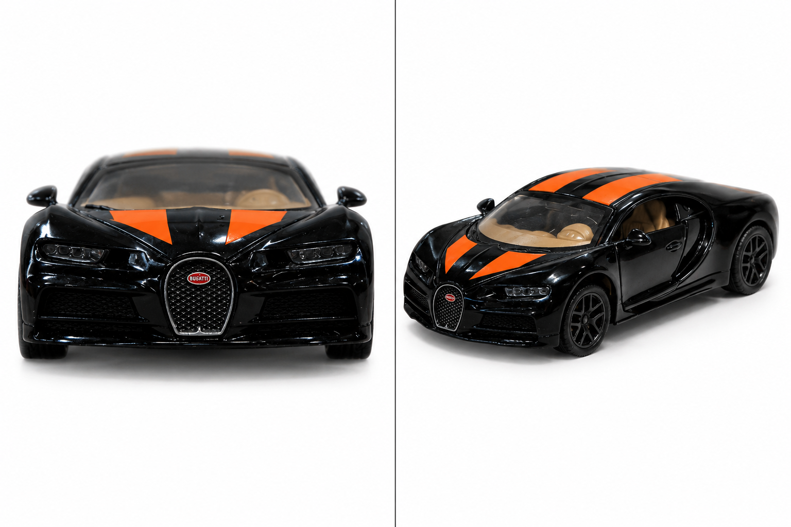 | 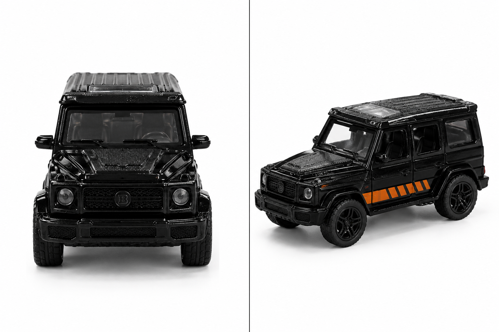 |

**Hipótese:** o Chiron, baixo e com linhas fluidas, deve apresentar menor arrasto do que o G500, alto e de formas retas, que gera uma esteira turbulenta maior.

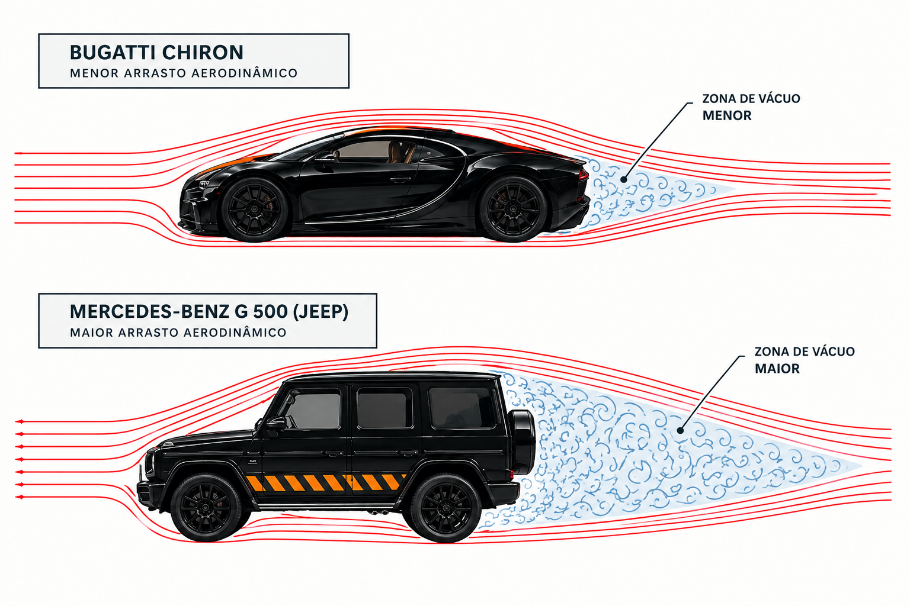

*Ilustração conceitual (não é resultado medido): a zona de vácuo/esteira atrás do G500 tende a ser maior.*

## 8. Resultados: Bugatti Chiron × Mercedes-Benz G500

### 8.1 Os três ensaios

| Teste 1 | Teste 2 | Teste 3 |
|---|---|---|
| 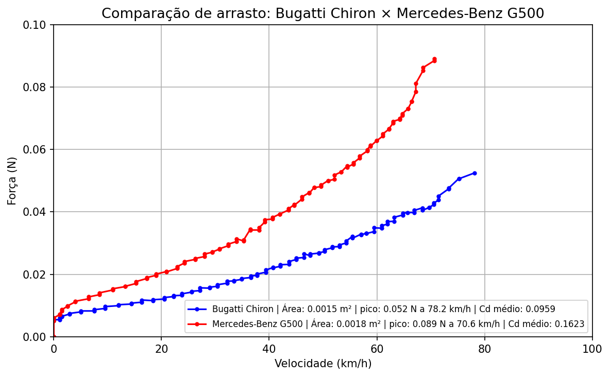 | 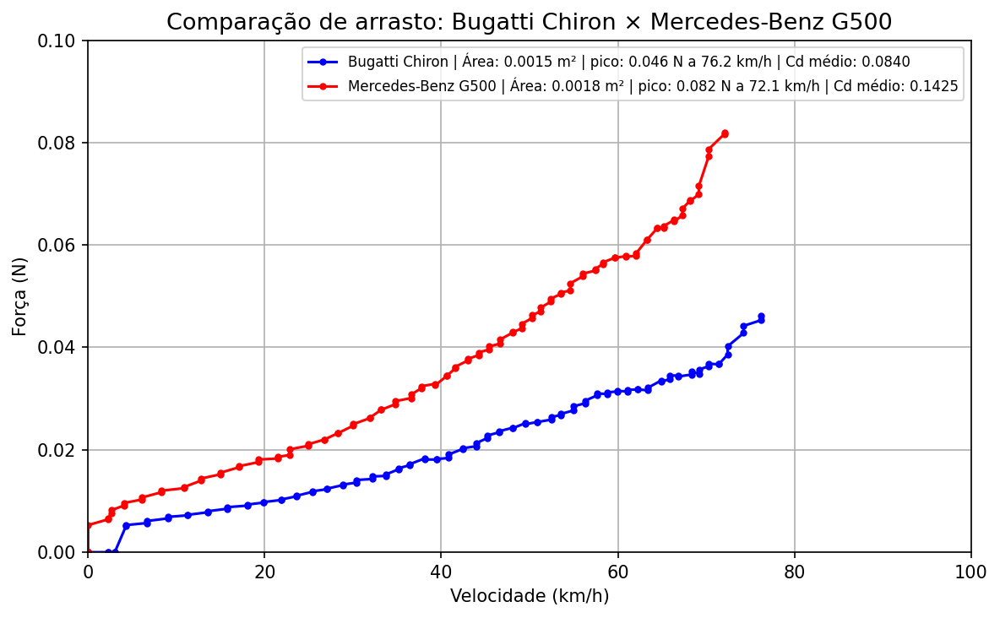 | 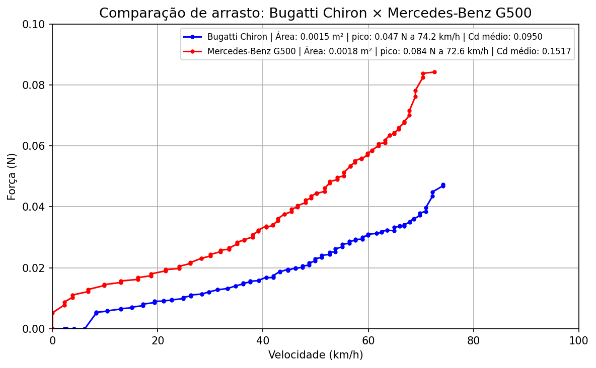 |

### 8.2 Dados extraídos dos gráficos

| Teste | Objeto | Área (m²) | Pico de força | Velocidade no pico | Cd médio |
|:---:|---|:---:|:---:|:---:|:---:|
| 1 | Bugatti Chiron | 0,0015 | 0,052 N | 78,2 km/h | 0,0959 |
| 1 | Mercedes-Benz G500 | 0,0018 | 0,089 N | 70,6 km/h | 0,1623 |
| 2 | Bugatti Chiron | 0,0015 | 0,046 N | 76,2 km/h | 0,0840 |
| 2 | Mercedes-Benz G500 | 0,0018 | 0,082 N | 72,1 km/h | 0,1425 |
| 3 | Bugatti Chiron | 0,0015 | 0,047 N | 74,2 km/h | 0,0950 |
| 3 | Mercedes-Benz G500 | 0,0018 | 0,084 N | 72,6 km/h | 0,1517 |


### 8.3 Estatística dos 3 ensaios

| Grandeza | Bugatti Chiron | Mercedes-Benz G500 | Razão G500 / Chiron |
|---|:---:|:---:|:---:|
| **Cd médio** | **0,092** ± 0,007 | **0,152** ± 0,010 | **1,66×** |
| Pico de força médio | 0,048 ± 0,003 N | 0,085 ± 0,004 N | 1,76× |
| Velocidade média no pico | 76,2 km/h | 71,8 km/h | — |
| Coef. de variação do Cd | 7,2 % | 6,5 % | — |

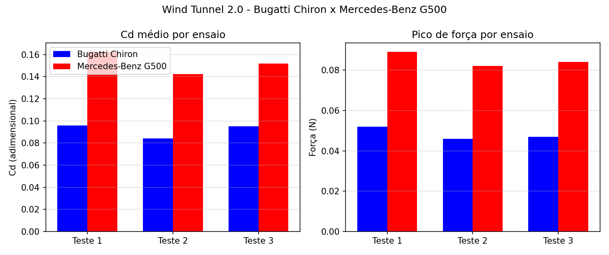

### 8.4 Comparação na mesma velocidade

Lendo as curvas em velocidades iguais (valores aproximados, lidos visualmente dos gráficos):

| Velocidade | Chiron | G500 | Razão |
|:---:|:---:|:---:|:---:|
| ~20 km/h | ≈ 0,012 N | ≈ 0,020 N | ≈ 1,7× |
| ~40 km/h | ≈ 0,019–0,021 N | ≈ 0,033–0,037 N | ≈ 1,7–1,8× |
| ~60 km/h | ≈ 0,031–0,035 N | ≈ 0,057–0,063 N | ≈ 1,8× |

Em toda a faixa de velocidades, nos três ensaios, **a curva do G500 permanece acima da do Chiron**.

## 9. Discussão e análise crítica dos dados

### 9.1 O que os dados mostram com clareza

1. **Ordenação consistente:** em todos os ensaios, o G500 apresentou mais força e maior Cd do que o Chiron. A hipótese inicial foi confirmada.
2. **Boa repetibilidade da comparação:** o coeficiente de variação do Cd (≈ 6–7 %) é pequeno diante da diferença entre os modelos (≈ 66 %). A razão G500/Chiron ficou entre 1,60 e 1,70 nos três testes (Cd: 0,1623/0,0959 = 1,69; 0,1425/0,0840 = 1,70; 0,1517/0,0950 = 1,60).
3. **Efeito da área:** parte da diferença de força vem da maior área frontal do G500 (0,0018 vs 0,0015 m², +20 %). O Cd remove esse efeito — e mesmo assim o G500 é ≈ 66 % maior, ou seja, **o formato, e não só o tamanho, explica a diferença**.
4. **Esteira:** o formato de caixa do G500 (para-brisa quase vertical, traseira abrupta, pneu sobressalente) favorece o descolamento do escoamento e uma esteira larga — coerente com a maior resistência observada.

### 9.2 Pontos de atenção (leitura crítica)

- **Valores absolutos de Cd abaixo dos de veículos reais.** Os Cds obtidos (≈ 0,09 e ≈ 0,15) são bem menores do que os de carros reais (da ordem de 0,3–0,4 para um supercarro e 0,4–0,55 para uma Classe G, conforme versão). Isso é esperado em um túnel caseiro, e pode vir de: número de Reynolds muito menor, **bloqueio** da seção de testes, definição da área de referência, calibração da velocidade e da célula de carga, e escoamento não uniforme. Por isso, **os resultados devem ser interpretados de forma relativa (comparativa), não como Cd oficial dos veículos.**
- **Degrau de força em velocidade zero.** Nas curvas há força de ≈ 0,005 N em velocidade próxima de zero (G500 nos três testes; Chiron no Teste 3). Nos testes 4 e 5, o Chiron fica em ≈ 0 N nos primeiros km/h e salta para ≈ 0,005 N. Indica **offset/zona morta** da medição (tara, atrito da haste, histerese). Esse offset **infla o Cd calculado em baixas velocidades**, onde a pressão dinâmica é pequena.
- **Expoente menor que 2.** Se F ∝ v², dobrar a velocidade quadruplicaria a força. Nos dados, de ≈ 40 para ≈ 78 km/h (×1,95) a força do Chiron (Teste 3) sobe ≈ 2,5× — um expoente efetivo de ≈ 1,4; no G500, ≈ 1,5. Causas plausíveis: offset de força, calibração do anemômetro em baixas velocidades e variação do Reynolds com a velocidade.
- **Subida abrupta no fim das curvas.** Em ≈ 65–72 km/h a curva do G500 fica quase vertical (a força continua subindo enquanto a velocidade praticamente satura). Hipótese: o PWM se aproxima do máximo e/ou o anemômetro satura, enquanto a força ainda aumenta; também pode haver efeito de bloqueio. **Merece investigação** com anemômetro de referência.
- **Picos em velocidades diferentes.** O Chiron foi até ≈ 74–78 km/h e o G500 até ≈ 71–73 km/h. Comparar picos de força diretamente não é equivalente a comparar na mesma velocidade — por isso a seção 8.4.
- **Média simples de Cd por ponto.** O Cd médio é a média dos Cds pontuais, e pontos de baixa velocidade (com offset) pesam bastante. Uma alternativa mais robusta é ajustar `F = ½ρCdA·v²` por mínimos quadrados, ou calcular o Cd apenas acima de uma velocidade mínima (ex.: > 20 km/h).
- **Amostra pequena.** São 3 ensaios por modelo; a incerteza reportada (desvio padrão, n = 3) é uma estimativa grosseira.

## 10. Conclusões

1. O Wind Tunnel 2.0 **cumpre o objetivo**: mede velocidade, força e temperatura, exibe os dados em tempo real e compara dois objetos no mesmo gráfico, com cálculo automático de Cd.
2. O **Bugatti Chiron** teve **menor arrasto** que o **Mercedes-Benz G500** em todos os ensaios: Cd médio ≈ **0,092** contra ≈ **0,152** (o G500 ≈ **66 % maior**), e pico de força ≈ **0,048 N** contra ≈ **0,085 N** (≈ **76 % maior**), mesmo com o Chiron testado em velocidades ligeiramente maiores.
3. O resultado é **coerente com a aerodinâmica esperada**: forma baixa e fluida (Chiron) versus forma alta e quadrada, com esteira ampla (G500).
4. A comparação é **repetível** entre ensaios (variação do Cd ≈ 6–7 %), o que valida o equipamento como **ferramenta comparativa**.
5. Os valores absolutos de Cd **não devem ser tomados como os dos veículos reais**; para isso seriam necessárias calibração rigorosa, correção de bloqueio e similaridade de Reynolds.
6. O projeto demonstra a cadeia completa **fenômeno físico → sensor → firmware → software → análise → conclusão**, que é a essência da instrumentação experimental.

## 11. Limitações e trabalhos futuros

- Calibrar a célula de carga com massas conhecidas e registrar a tara antes e depois de cada ensaio.
- Calibrar o anemômetro contra uma referência independente.
- Medir a razão de bloqueio (área do modelo ÷ área da seção) e aplicar correção.
- Eliminar/compensar o offset de força em velocidade zero.
- Mais repetições (≥ 10) e barras de erro nos gráficos.
- Ajustar `F = ½ρCdA·v²` por regressão em vez de média simples de Cd.
- Salvar os dados brutos (CSV) além dos gráficos.
- Estudar variações de ângulo de ataque e de geometria (spoilers, rebaixamento).
- Usar a fumaça para análise qualitativa da esteira de cada modelo.

## 12. Segurança

- Mantenha **mãos e objetos longe da hélice** com o ventilador ligado; use sempre a grade de proteção.
- Use o **botão de emergência** para cortar a alimentação em caso de anomalia.
- O sistema de aquecimento da fumaça trabalha com **temperaturas elevadas**: use componentes dimensionados para o calor, isolamento adequado e proteção contra sobretemperatura; nunca o deixe ligado sem supervisão.
- Verifique a alimentação e o aterramento antes de ligar à rede elétrica.


## 13. Autoria e licença

**Autor:** Filipe da Silva Rupp — idealização, construção do equipamento, firmware, software, ensaios e análise.


---


